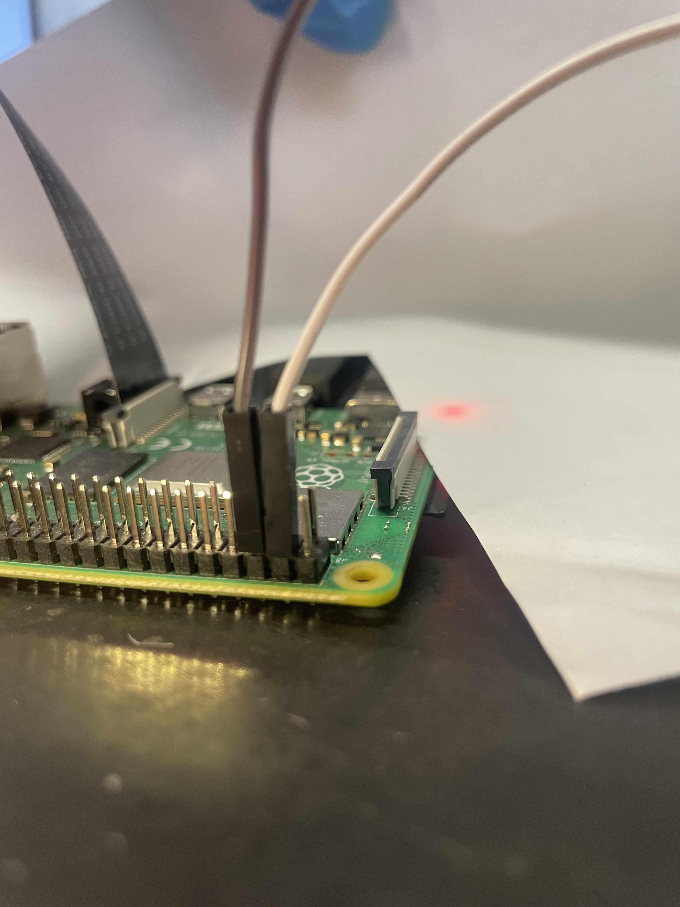
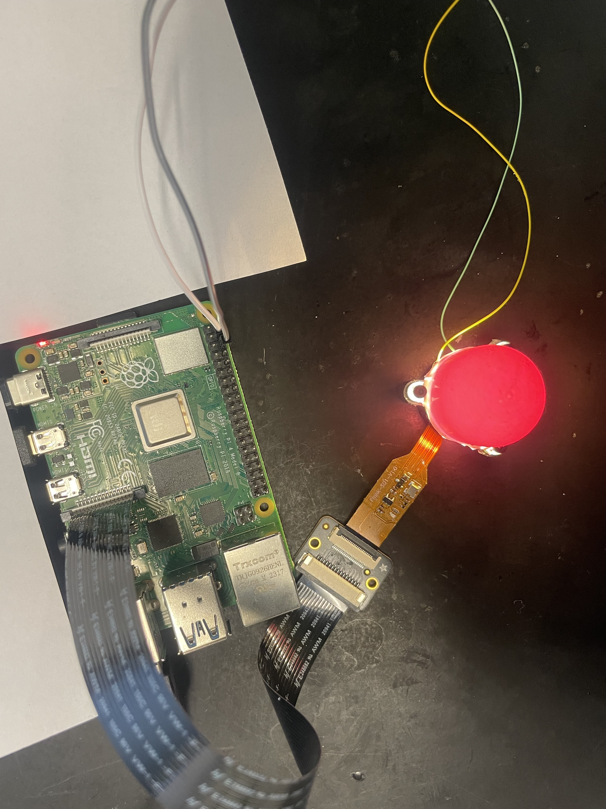

# Data Collection and Reconstruction Guide

How to capture tactile sensor data that can be reconstructed with the **existing, saved calibration**.
You do not calibrate anything. You only capture reference frames and press frames, using the same camera settings as the calibration.

---

## 0. Sensor integration

Connect the sensor to the Raspberry Pi **with the Pi powered off and unplugged**.

### Step 1: LED power → Raspberry Pi 5 V pins

Connect the sensor's LED power wires to the Pi's 40-pin header:

| LED wire | Raspberry Pi pin (physical number) |
|---|---|
| **+ (power)** | **Pin 2 or Pin 4**: 5 V |
| **– (ground)** | **Pin 6** (or any GND pin: 9, 14, 20, 25, 30, 34, 39) |

Pin 1 is the corner pin marked with a square pad. Odd-numbered pins are in the row nearest the board's centre, even-numbered pins in the row along the board's edge.
Double-check polarity before powering on. 5 V on the wrong wire can damage the LEDs.

<p align="center">
  
  <br>
  <sub><i>Step 1: LED power wires on the Raspberry Pi 5 V and GND pins</i></sub>
</p>

### Step 2: Camera FPC cable → Raspberry Pi camera port

1. Gently lift the locking tab of the Pi's camera connector (on a Raspberry Pi 5, use the **CAM/DISP 0** port).
2. Slide the camera's flat (FPC) cable fully in, straight and with the metal contacts facing the contacts inside the connector, as shown in the figure.
3. Push the locking tab back down. The cable should not pull out with a light tug.

> A Raspberry Pi 5 uses a smaller 22-pin camera connector. A camera with a standard 15-pin cable needs a 15-to-22-pin adapter cable.

<p align="center">
  
  <br>
  <sub><i>Step 2: camera FPC cable in the Raspberry Pi camera port</i></sub>
</p>

After both steps, power on the Pi. Check that the camera is detected.

---

> **Note: running on other Linux computers**
>
> This setup was built and tested on a **Raspberry Pi**, but the software isn't tied to it. It runs on any Linux PC with Python, NumPy and OpenCV. [Please follow the communication setup of the previous repo I shared in that case]
> - **Processing saved data** (reconstruction, point clouds, videos) needs no changes.
> - **Live capture** (`capture_calibration_images_locked.py`, `realtime_3d_reconstruction.py`) reads frames through the Raspberry Pi camera library (`picamera2`).
>   On another computer, only the **image-feed lines** need replacing: the camera setup and the `capture_array()` calls, for example with OpenCV's `cv2.VideoCapture`.
>   Keep the same resolution (1280 × 720), the BGR channel order, and fixed (manual) exposure and white balance.
>
> The saved calibration belongs to **this sensor's camera and LEDs**. A different camera, or the same camera with different image processing, needs a new calibration.

## 1. Files you need

Put these in the same arrangement as on the repo/usb drive on the Raspberry Pi and run every command from that folder:

| File | Purpose |
|---|---|
| `capture_calibration_images_locked.py` | The capture program |
| `drift_correction.py` | Used by the live view (must be next to the capture script) |
| `camera_settings.json` | The exact exposure, gain and white balance used for calibration |
| `roi_config.json` | Where the sensor appears in the camera image |

Install once:
```bash
sudo apt install -y python3-picamera2
pip install numpy opencv-python        # add --break-system-packages on newer Pi OS if pip refuses
```

---
## Please directly configure Step 8 for live reconstruction

## 2. Configure the capture script (once per session)

Open `capture_calibration_images_locked.py` and edit the CONFIG block at the top:

```python
REF_DIR = "./data/2026-10-13_session1/ref"       # NEW folder for every session
SAMPLE_DIR = "./data/2026-10-13_session1/frames"
LOAD_SETTINGS_PATH = "./camera_settings.json"    # REQUIRED: use the calibration's camera settings
```

- **`LOAD_SETTINGS_PATH` must point to `camera_settings.json`.** If it is `None`, the camera uses different settings and the calibration won't match your data.
- **Use a new `REF_DIR` for every session.** Reconstruction averages every reference in that folder, so old references would get mixed in.
- Don't change anything else.

---

## 3. Before capturing

1. **Warm up the LEDs:** turn them on and leave them on for **5–10 minutes**. Keep them on for the whole session.
2. Make sure nothing is touching the sensor.
3. Make sure no other program is using the camera.

---

## 4. Capture

```bash
python capture_calibration_images_locked.py
```

### Step 1: ROI check
A window shows the camera image with a green circle around the sensor. Press **ENTER** to keep it. Don't redraw it.

### Step 2: References (sensor untouched)
- Press **ENTER** 30 times. Each press saves one reference frame.
- **Don't touch the sensor during this step.**
- Press **N** when done.

### Step 3: Data
A second window, the **live press view**, shows where and how hard the sensor is pressed. It is black when nothing touches it.
The `press peak` number helps you press to a similar depth each time.

Choose how to save:

| Key | Action |
|---|---|
| **ENTER** | Save one frame |
| **S** | Start recording every frame |
| **E** | Stop the recording |
| **Q** | Quit (a running recording is stopped and fully saved first) |

You can make as many recordings as you want in one session. Each one gets its own number.

The `[` and `]` keys (exposure) are disabled on purpose, because exposure is locked to the calibration value.

---

## 5. What gets saved

```
data/2026-10-13_session1/
├── ref/
│   ├── ref_0000.png ... ref_0009.png        # references (unpressed)
├── ref_camera_settings_used.json           # settings this session actually used
└── frames/
    ├── sample_0000.png, sample_0001.png ... # single frames (ENTER)
    ├── rec01_00000.png, rec01_00001.png ... # recording 1 (S ... E)
    ├── rec01_timestamps.csv                 # frame, file, time_s
    ├── rec02_00000.png ...                  # recording 2
    └── rec02_timestamps.csv
```

- All images are full, raw camera frames (the live view never changes what is saved).
- Nothing is ever overwritten. Rerunning into the same folder continues the numbering.

**To hand the data over for reconstruction, deliver the whole session folder (`ref/` + `frames/`).**
The frames can only be reconstructed together with the references from the **same session**.

---

## 6. Rules for good data

- **Same session, same references:** capture the references and frames in one run, without turning the LEDs off in between.
- **Re-take references regularly:** start a new session (new folders) every 15–20 minutes, or whenever the live view no longer looks black with nothing touching the sensor.
- **Don't change the hardware:** no changes to the LEDs, camera, mounting or sensor coating. Any change invalidates the calibration.
- **Don't edit** `camera_settings.json` or `roi_config.json`.
- **Typical press range:** the calibration covers depths up to roughly 0.6 mm. Deeper presses are reconstructed less accurately.

---

## 7. Troubleshooting

| Problem | Fix |
|---|---|
| `ModuleNotFoundError: drift_correction` | Put `drift_correction.py` in the same folder as the capture script |
| `FileNotFoundError: camera_settings.json` | Check `LOAD_SETTINGS_PATH` and that the file is in the folder |
| Camera busy / can't open camera | Close other camera programs, or find the one holding it: `sudo fuser -v /dev/media* /dev/video*` |
| Live view glows everywhere with nothing touching the sensor | LEDs not warmed up yet. Wait, then start a new session with new references |
| Recording reports dropped frames | The disk is too slow. Set `RECORD_SHOW_DIFF = False` in the CONFIG block |
| "Clipped" readout turns red | Report it. Exposure is locked, so the lighting or sensor may have changed |

---

## 8. Real-time 3D reconstruction (live view)[To be tested]

Use this to **see** the sensor's 3D shape live while pressing, for example to check a setup or for demos.
It doesn't save a dataset. For data, use the capture steps above.

### Extra files needed
In the same folder as the files from section 1:

| File | Purpose |
|---|---|
| `realtime_3d_reconstruction.py` | The live 3D program |


### Run
1. Warm up the LEDs (–5 min, same as section 3) and don't touch the sensor.
2. Start:
   ```bash
   python realtime_3d_reconstruction.py
   ```
3. The program then works on its own:
   - **Exposure tuning:** it adjusts the exposure until `B_max` (brightest blue level on the sensor) reaches **190**, then locks it.
   - **Reference:** it averages the next **50 frames**. **Keep the sensor untouched** until the 3D window opens.
   - **Live 3D:** the fingertip surface is shown with lighting and updates with every frame. A small depth map is shown in the corner.

The ROI is loaded from `roi_config.json` automatically. There is nothing to select.

### Controls (in the 3D window)

| Input | Action |
|---|---|
| Left-drag | Rotate the view |
| Mouse wheel | Zoom |
| **+** / **-** | Exaggerate the depth (display only; starts at ×3) |
| **c** | Switch between gray shading and colour-by-depth |
| **f** | Turn the view to face the deepest point |
| **v** | Reset the view |
| **b** | Re-take the reference (sensor untouched!). Use it if the surface shows bumps with nothing touching it |
| **p** | Save the current 3D point cloud (true depth, mm) to `pcd_realtime/frame_####.pcd` |
| **q** / ESC | Quit |

### Notes
- Please change the reconstruction script according to your visualization purposes.